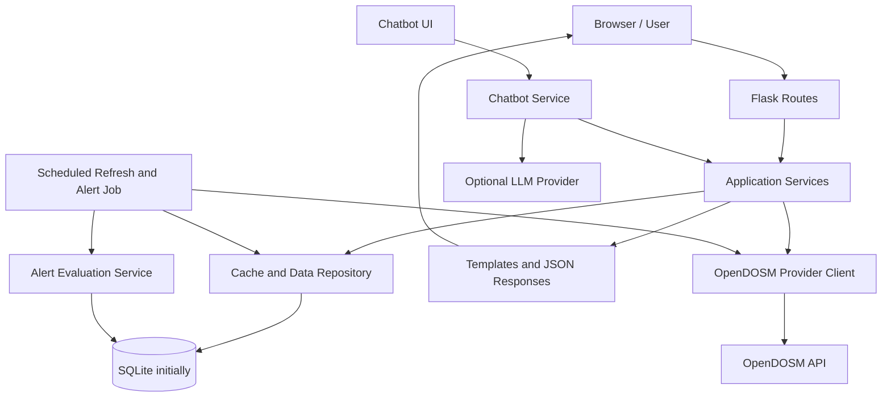

# Myconomy — System Design

## 1. Architecture Overview

Myconomy will use a modular Flask application. Routes handle HTTP requests and responses; service modules implement business rules; repository/data-access modules handle database operations; a provider client retrieves official data; templates and JavaScript render the interface.



The chatbot must use application services to retrieve relevant verified data. It must not treat the language model as the source of statistical truth.

## 2. Proposed Project Structure

```text
myconomy/
├── app/
│   ├── __init__.py
│   ├── config.py
│   ├── extensions.py
│   ├── models/
│   │   ├── user.py
│   │   ├── indicator.py
│   │   ├── data_point.py
│   │   ├── cache_entry.py
│   │   ├── expense.py
│   │   ├── alert_rule.py
│   │   └── notification.py
│   ├── routes/
│   │   ├── main.py
│   │   ├── dashboard.py
│   │   ├── calculator.py
│   │   ├── expenses.py
│   │   ├── alerts.py
│   │   ├── widget.py
│   │   ├── chatbot.py
│   │   ├── indicators.py
│   │   ├── learning.py
│   │   └── auth.py
│   ├── services/
│   │   ├── opendosm_client.py
│   │   ├── data_service.py
│   │   ├── calculator_service.py
│   │   ├── expense_service.py
│   │   ├── alert_service.py
│   │   └── chatbot_service.py
│   ├── templates/
│   ├── static/
│   │   ├── css/
│   │   ├── js/
│   │   └── images/
│   └── tasks/
│       ├── refresh_data.py
│       └── evaluate_alerts.py
├── tests/
│   ├── unit/
│   ├── integration/
│   └── routes/
├── migrations/
├── instance/
├── .env.example
├── .gitignore
├── requirements.txt
├── config.py
└── run.py
```

This is a proposed structure, not a requirement to create every module on day one. Start with the modules needed for the first milestone and expand gradually.

## 3. Request and Data Flow

### 3.1 Dashboard
1. Browser requests the dashboard.
2. Flask route calls the data service.
3. Data service checks the cache/database for a usable snapshot.
4. If the cache is fresh, return it.
5. If stale or missing, attempt a bounded upstream refresh according to policy.
6. Validate the response before saving.
7. If refresh fails, return the last successful snapshot with a stale-data warning when available; otherwise show a clear unavailable state.
8. Render the values, reference period, retrieval time, and source.

### 3.2 Historical Data and Calculator
1. User selects an amount and two periods.
2. Server validates the amount and periods.
3. Data service retrieves the correct series and both period values.
4. Calculator service applies `amount × (target CPI / source CPI)`.
5. Server returns the result, formula, values, periods, and source.
6. If either period is unavailable or values are incompatible, explain the limitation rather than guessing.

### 3.3 Personal Spending
1. User signs in.
2. Server checks ownership and validates submitted values.
3. Expense service saves or updates the record.
4. Summaries aggregate only the current user's records.
5. Comparison logic uses compatible national CPI periods and labels the result as indicative.

### 3.4 Refresh and Alerts
1. A scheduler runs at a configurable interval suitable for the source's release frequency.
2. Refresh job requests data with timeouts and bounded retries/backoff.
3. Valid data is stored with source and reference-period metadata.
4. Job compares the new snapshot with the prior successful snapshot.
5. Alert service evaluates active rules and creates idempotent notification records.
6. A delivery service may send configured notifications; failures are logged and retried safely.

### 3.5 Chatbot
1. User submits a question.
2. Chatbot service classifies the request as a supported data question or a general educational question.
3. For statistical questions, it retrieves relevant data and metadata from the application.
4. It constructs a constrained prompt with those facts and asks the model to explain them, if an LLM is configured.
5. The response includes the relevant period and source.
6. If data is missing, the chatbot says so. If the LLM is unavailable, offer a simple non-AI fallback or a clear error.

## 4. Feature Modules

| Feature | Main components | Main dependencies |
|---|---|---|
| Economic Dashboard | dashboard route, data service, charts | validated indicator data |
| Purchasing Power Calculator | calculator route/service | compatible CPI series |
| Cost-of-Living Tracker | auth, expense route/service | user and expense records |
| Inflation Alerts | alert rules, scheduler, notifications | refreshed data, scheduler |
| Quick Stats Widget | widget route/template | cached latest indicator |
| Economic Chatbot | chatbot route/service, retrieval | data service; optional LLM |
| Multi-Indicator Explorer | indicator registry, charts | verified dataset mappings |
| Learn & Understand | learning routes/templates | reviewed content and sources |

## 5. API Client and Data Handling

- Keep the OpenDOSM base URL and dataset identifiers in configuration.
- Use explicit connect/read timeouts.
- Check HTTP status codes and parse JSON defensively.
- Validate response shape and required fields against verified dataset mappings.
- Treat an empty response as a valid but potentially unexpected state; do not automatically erase prior good data.
- Handle pagination where needed for historical series.
- Use per-dataset cache TTLs based on release frequency, not a single arbitrary TTL for all datasets.
- Apply bounded retries with exponential backoff for transient failures and respect rate-limit responses.
- Avoid retrying non-retryable client errors indefinitely.
- Store `fetched_at`, `reference_period`, source URL/dataset ID, and refresh status separately.
- Never claim data is live merely because it was recently fetched.

## 6. Security Design

- Use Flask's application factory pattern and environment-based configuration.
- Keep `SECRET_KEY` and any LLM credentials outside source control.
- Hash passwords; never store plaintext passwords.
- Use CSRF protection on forms and state-changing requests.
- Use secure cookies and HTTPS in production.
- Enforce authorisation and record ownership on every personal-data route.
- Apply server-side validation and reasonable request limits.
- Avoid exposing stack traces, secrets, or personal data in error messages/logs.
- Consider rate limiting login and chatbot endpoints.

## 7. Deployment Notes

For local development, Flask and SQLite are sufficient. For deployment:
- Use a production WSGI server rather than Flask's development server.
- Use HTTPS and production-safe cookie settings.
- Run scheduled jobs separately from web workers.
- Consider PostgreSQL and a task queue if multiple application instances or reliable task retries are needed.
- Back up the database and test restoration.
- Configure health checks, structured logs, and monitoring for refresh failures.

## 8. Design Decisions to Confirm

- Exact OpenDOSM dataset identifiers and schemas for all indicators.
- Whether authentication is required in the first milestone.
- Which chatbot provider, if any, will be used and its cost/privacy implications.
- Initial alert delivery method (in-app first is recommended).
- Cache implementation: database-backed cache initially; Redis only if deployment scale warrants it.
