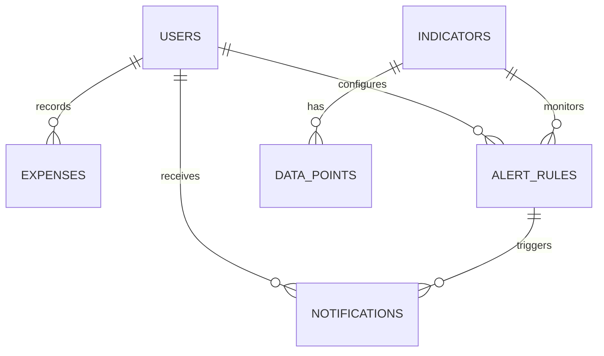

# Myconomy — Database Design

## 1. Overview

SQLite is proposed for local development and the first single-instance version. SQLAlchemy is recommended so models and queries can be maintained consistently and migrated later if PostgreSQL is needed.

The database stores user accounts, indicator metadata, validated data points, cache/refresh metadata, personal expenses, alert rules, and notifications. Educational content can initially live in Markdown/templates.

## 2. Main Entities

### 2.1 `users`
Stores account identity and authentication information.

| Field | Type | Rules |
|---|---|---|
| id | Integer | Primary key |
| email | String | Required, unique, normalised |
| password_hash | String | Required; never store plaintext |
| display_name | String | Optional |
| created_at | DateTime | Required |
| is_active | Boolean | Required, default true |

### 2.2 `indicators`
Registry of supported indicators and their source mappings.

| Field | Type | Rules |
|---|---|---|
| id | Integer | Primary key |
| code | String | Required, unique, e.g. internal code |
| name | String | Required |
| description | Text | Optional |
| provider | String | Required, e.g. OpenDOSM |
| dataset_id | String | Required; verified provider dataset identifier |
| unit | String | Required, e.g. index points or percent |
| frequency | String | Required; e.g. monthly or quarterly |
| schema_mapping_json | Text | Required; verified field mapping |
| source_url | String | Required |
| is_enabled | Boolean | Required, default true |

Do not assume every dataset has the same fields. Store a verified mapping for each dataset and validate it in the provider/data service.

### 2.3 `data_points`
Normalised observations used by charts, calculators, alerts, and chatbot retrieval.

| Field | Type | Rules |
|---|---|---|
| id | Integer | Primary key |
| indicator_id | Integer | Foreign key to indicators |
| reference_period | String or Date | Required; canonical period representation |
| geography | String | Optional; e.g. national or state where relevant |
| category | String | Optional; for breakdowns if supported |
| value | Numeric | Required when observation is numeric |
| unit | String | Required |
| source_record_json | Text | Optional; bounded raw record for traceability |
| fetched_at | DateTime | Required |
| source_updated_at | DateTime | Optional if provider supplies it |

Add a uniqueness rule based on the dataset's actual dimensions, such as `(indicator_id, reference_period, geography, category)`. Confirm dimensions per dataset before finalising the constraint. Store decimal values using a suitable numeric representation where precision matters.

### 2.4 `cache_entries`
Tracks cached provider responses or derived snapshots.

| Field | Type | Rules |
|---|---|---|
| id | Integer | Primary key |
| cache_key | String | Required, unique |
| payload_json | Text | Required |
| fetched_at | DateTime | Required |
| expires_at | DateTime | Required |
| reference_period | String | Optional |
| status | String | Required: success/stale/error |
| last_error | Text | Optional; sanitised |

Do not store secrets or full request headers. A database cache is sufficient initially; Redis can be introduced if needed.

### 2.5 `expenses`
Personal monthly spending records.

| Field | Type | Rules |
|---|---|---|
| id | Integer | Primary key |
| user_id | Integer | Foreign key to users |
| amount | Numeric | Required, non-negative |
| category | String | Required |
| expense_month | Date or String | Required; normalised to month |
| note | String | Optional, length-limited |
| created_at | DateTime | Required |
| updated_at | DateTime | Required |

Index `user_id` and `expense_month`. All queries and mutations must verify that the record belongs to the authenticated user.

### 2.6 `alert_rules`
User-defined alert configuration.

| Field | Type | Rules |
|---|---|---|
| id | Integer | Primary key |
| user_id | Integer | Foreign key to users |
| indicator_id | Integer | Foreign key to indicators |
| alert_type | String | Required: threshold or new_data |
| threshold_value | Numeric | Nullable; required for threshold rules |
| comparison_operator | String | Nullable; allow only supported operators |
| is_active | Boolean | Required, default true |
| delivery_method | String | Required; initially in_app |
| created_at | DateTime | Required |
| updated_at | DateTime | Required |

Validate the threshold and operator combination server-side. Do not permit arbitrary expressions to be evaluated.

### 2.7 `notifications`
Records alert events and their delivery state.

| Field | Type | Rules |
|---|---|---|
| id | Integer | Primary key |
| user_id | Integer | Foreign key to users |
| alert_rule_id | Integer | Foreign key to alert_rules, nullable if system notice |
| event_key | String | Required; unique idempotency key |
| title | String | Required |
| message | Text | Required |
| reference_period | String | Optional |
| source_url | String | Optional |
| created_at | DateTime | Required |
| read_at | DateTime | Nullable |
| delivery_status | String | Required |

Use a unique `event_key` so the same rule does not create duplicate notifications for the same source event.

## 3. Relationships

`cache_entries` is independent and keyed by a stable cache key. If a refresh-run history table is added later, it should record start/end times, outcome, dataset, and a sanitised error summary.

## 4. Data Retention and Privacy

- Keep only the personal information required for account and feature functionality.
- Do not store bank credentials or bank transaction data.
- Allow users to delete their own expense records; define account deletion behaviour before launch.
- Avoid storing unnecessary personal details in expense notes.
- Apply a retention policy to cached raw payloads and logs.
- Back up the database securely and never commit a real database containing personal data to GitHub.

## 5. Indexes and Constraints

Recommended initial indexes:
- Unique index on `users.email`.
- Unique index on `indicators.code`.
- Unique dataset observation key based on verified dimensions.
- Index on `expenses(user_id, expense_month)`.
- Index on `alert_rules(user_id, is_active)`.
- Unique index on `notifications.event_key`.
- Index on `notifications(user_id, created_at)`.

Use database migrations for schema changes rather than manually changing a deployed database.

## 6. Derived Values

Do not need to persist every derived chart or calculator result initially. Calculate these from validated data points and cache expensive results only when justified.

For a CPI-based purchasing-power comparison:

`equivalent_amount = amount × (target_period_CPI / source_period_CPI)`

Use CPI values from the same compatible series and clearly identify the source and target periods. The direction of the ratio must be tested to avoid reversing the comparison.

## 7. Open Questions Before Implementation

- Confirm exact fields and period formats for each OpenDOSM dataset.
- Decide whether category/geography dimensions are needed for each indicator.
- Decide whether users can export or delete their personal data.
- Confirm whether notifications remain in-app or later use email.
- Determine whether a separate refresh-run table is useful for operational monitoring.
